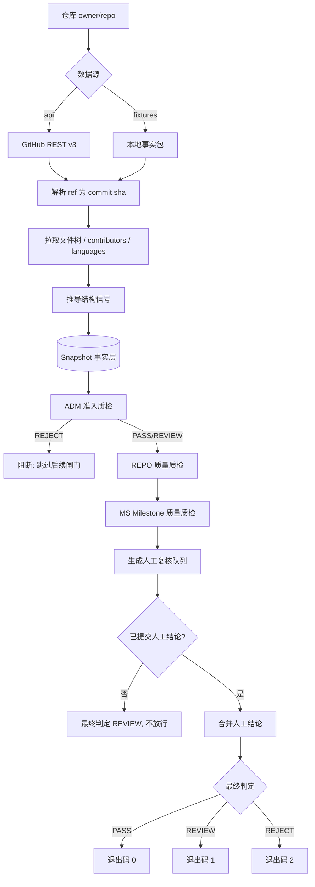

# 第一章 为什么需要仓库质检

> **本章导读**：本章不写代码，只解决一个问题——**为什么从 GitHub 挑仓库和里程碑做 AI Coding 任务这件事，必须有质检环节**。我们会先看人工挑选会踩的坑，再看本项目如何把判断固化成流程。

---

## 1.1 一个看起来很简单的任务

&emsp;&emsp;假设你接到这样一个需求：**为编码智能体构建一批真实的开发任务**。

&emsp;&emsp;直觉上的做法很直接：打开 GitHub，找几个 star 多的活跃仓库，翻翻它们的 Milestone，把里面的 issue 挑出来，整理成任务。听起来一天就能搞定。

&emsp;&emsp;但如果你真的做过一遍，就会发现事情没那么轻松。问题不在于"找不到仓库"，而在于**你无法确认自己找对了**。

---

## 1.2 人工挑选的四个病症

### 病症一：成本高，且随规模爆炸

&emsp;&emsp;判断一个仓库是否合适，你需要：读 README 理解项目定位、看目录结构判断工程规范、检查有没有测试、确认 CI 是否配置、翻 Milestone 看任务粒度、逐个点开 issue 看描述是否清楚……

&emsp;&emsp;单个仓库大概 20 到 40 分钟。**十个仓库就是半天，一百个仓库就是两周。** 而且这个成本无法通过"更有经验"来显著压缩。

### 病症二：口径不一致

&emsp;&emsp;更麻烦的是，**换个人结论就变了**。

&emsp;&emsp;你判断"这个仓库测试挺全的"，同事可能觉得"测试覆盖率明显不够"。你说"这个 Milestone 任务粒度合适"，同事可能认为"8 个任务太碎了"。这些判断没有统一的标尺，讨论起来只能各说各话。

&emsp;&emsp;结果就是：**同样的仓库，不同人给出不同结论，且谁也无法说服谁。**

### 病症三：结论不可复现

&emsp;&emsp;三个月后有人问你："当初为什么选这个仓库？"

&emsp;&emsp;你打开它的 GitHub 页面，发现主分支已经往前跑了 200 个 commit，当时的 Milestone 已经被关闭、issue 被重新归类、甚至仓库结构都重构了。**你无法还原当时的判断依据。**

&emsp;&emsp;这就是为什么本项目坚持**快照必须钉在 commit sha 上**——分支名是会漂移的，锚点必须是不可变的。

### 病症四：隐藏陷阱

&emsp;&emsp;这是最要命的一类问题，因为它们**不会主动暴露**，往往在你已经投入成本之后才浮出水面。

---

## 1.3 四个真实的陷阱

&emsp;&emsp;下面这些场景，每一个都能让一批"看起来很好"的采集工作全部作废。

### 陷阱一：仓库已归档

&emsp;&emsp;你找到一个 star 数很高、结构漂亮的库，Milestone 里躺着十几个任务，看起来很完美。

&emsp;&emsp;但你漏看了一行小字：**This repository has been archived。**

&emsp;&emsp;归档意味着项目停止演进。那些 Milestone 不是"未来的开发计划"，而是**历史遗留的待办清单**——不会有人再推进它们。你基于它设计的任务，本质上是在让智能体做一道**没有真实约束的练习题**，而不是参与一次真实开发。

> **本项目如何处理**：`ADM-02` 检查项，**硬性阻断**。归档仓库一票否决，并且跳过后续所有闸门。

### 陷阱二：许可证是 `NONE`

&emsp;&emsp;你采了一批代码，整理成任务，发布出去。然后收到一封邮件。

&emsp;&emsp;问题出在许可证上。GitHub API 返回的许可证字段有三种取值，它们的**法务含义完全不同**：

| 取值 | 含义 | 后果 |
| --- | --- | --- |
| `MIT` 等标准 SPDX | 授权明确 | ✅ 可以采集 |
| `NOASSERTION` | 有 LICENSE 文件，但不是标准模板 | 🟡 边界不清，需人工确认 |
| `NONE` | **根本没有许可证文件** | ❌ 默认保留全部权利，不可采集 |

&emsp;&emsp;`NONE` 意味着**作者没有授予你任何权利**。哪怕代码公开可见，也不等于可以再分发、改造。这是很多采集工作踩过的坑。

> **本项目如何处理**：`ADM-04`，`NONE` 判 0 分（不可采集），`NOASSERTION` 判 0.6 分（转人工确认）。

### 陷阱三：Milestone 下 0 个任务

&emsp;&emsp;你看到一个标题很明确的 Milestone——比如"v2.0 性能优化"，描述写得头头是道。

&emsp;&emsp;点进去一看：**0 个 issue，0 个 closed，0 个 open。**

&emsp;&emsp;它只是一个"占位符"，或者创建后就没人维护了。你无法从中提取任何任务，也无从判断当初的开发意图。

> **本项目如何处理**：`MS-01`（存在 Milestone）与 `MS-03`（任务边界可界定）双重把关，`MS-03` 为硬性阻断。

### 陷阱四：没有测试，AI 产出无法验证

&emsp;&emsp;这个陷阱最隐蔽，因为它**不会阻止你采集，只会让你的任务失去意义**。

&emsp;&emsp;一个仓库功能完整、文档齐全、Milestone 任务清晰——但它没有任何测试，也没配 CI。

&emsp;&emsp;现在让智能体去完成其中一个任务。它改了代码，提交了一份看起来合理的实现。**请问：你怎么判断它做对了？**

&emsp;&emsp;答案是：你只能靠人工 review，而人工 review 的结论又是主观的。任务的可评测性就此崩塌——**这就从一道"工程题"退化成了"作文题"**。

> **本项目如何处理**：`REPO-03`（测试与回归护栏，权重 1.5）与 `MS-05`（结果可验证）。注意测试检查**权重高于**其他项，因为它直接决定任务是否有意义。

---

## 1.4 问题的本质

&emsp;&emsp;把这四个陷阱放在一起看，会发现一个共同点：

> **它们都不是"代码写得好不好"的问题，而是"这个仓库适不适合作为任务来源"的问题。**

&emsp;&emsp;而这类判断有三个特征，恰好都是人工流程的软肋：

1. **需要结构化的事实**——文件数、测试占比、CI 配置、任务粒度，这些都能从 API 拿到，人工去数纯属浪费；
2. **需要一致的口径**——什么算"测试足够"？什么算"任务粒度合适"？必须写成明确的阈值；
3. **需要留痕与复现**——结论必须附带依据，且任何时候都能重跑验证。

&emsp;&emsp;**这正是本项目存在的理由**：把这类判断从"人的经验"变成"可执行的规则"。

---

## 1.5 本项目的解法

&emsp;&emsp;`hello-repoqa` 的设计可以浓缩成三句话：

1. **采集只产出事实**——仓库在某个 commit 上的真实状态，不夹带判断；
2. **质检规则声明式**——每条规则有稳定 ID、明确权重、判定依据，可审计、可调参、可回归；
3. **人工只做一轮终审**——机器判不准的部分才交给人，且必须留痕。

### 整体架构

```
                    ┌──────────────────────────────────────┐
                    │  collector  采集层                    │
                    │  api ──┐                             │
                    │        ├──▶ Snapshot（事实层，不可变） │
                    │  fixtures ──┘                        │
                    └────────────────┬─────────────────────┘
                                     │  只产出事实
                                     ▼
                    ┌──────────────────────────────────────┐
                    │  rubric + rules  规则层（只读事实）    │
                    │  ADM ──▶ REPO ──▶ MS                 │
                    │  21 checks · 加权打分 · 硬性阻断       │
                    └────────────────┬─────────────────────┘
                                     ▼
                    ┌──────────────────────────────────────┐
                    │  manual  单轮人工质检                 │
                    │  5 问裁决 · 结论合并 · 审计留痕        │
                    └────────────────┬─────────────────────┘
                                     ▼
                    ┌──────────────────────────────────────┐
                    │  report  报告渲染                     │
                    │  Markdown · JSON · JUnit XML          │
                    └──────────────────────────────────────┘
```

&emsp;&emsp;用 Mermaid 表示数据流（GitHub 上可直接渲染）：



### 一个关键设计：事实层与规则层解耦

&emsp;&emsp;上图里最值得注意的一点是：**`api` 和 `fixtures` 两条路径汇聚到同一个 `Snapshot` 结构**。

&emsp;&emsp;这意味着下游的 21 条质检规则**完全不需要知道数据是从哪来的**。带来的好处非常实际：

- 规则可以在 CI 里用 fixtures 稳定回归，不受网络和 API 配额影响；
- 新增数据源（GitLab、Gitee）时，只要产出同样的 `Snapshot`，**规则层零改动**；
- 调试规则时不需要反复请求 API，本地 fixtures 秒级迭代。

&emsp;&emsp;我们会在[第二章](../chapter2/第二章%20固定快照采集原理.md)详细展开采集层的实现。

---

## 1.6 三个闸门，一次人工

### 闸门的设计逻辑

&emsp;&emsp;质检被组织成三个**职责边界清晰**的闸门，每个回答一个不同层次的问题：

| 闸门 | 回答的问题 | 权重 | 性质 |
| --- | --- | --- | --- |
| **ADM** 准入 | 这个仓库**配不配**进采集池？ | 0.2 | **阻断型** |
| **REPO** Repo 质量 | 工程本身**值不值得**作为任务来源？ | 0.4 | 累积式 |
| **MS** Milestone 质量 | 这个里程碑**能否**拆成可评估的任务？ | 0.4 | 累积式 |

&emsp;&emsp;注意 **ADM 是"阻断型"**：它不通过就直接跳过 REPO 和 MS。

&emsp;&emsp;为什么这样设计？因为**在明显不合格的仓库上继续算质量分是浪费**。一个已归档的仓库，它的测试覆盖率是 60% 还是 90%，有意义吗？没有。既然 `ADM-02` 已经一票否决，后面的闸门就不必执行了。

&emsp;&emsp;这不仅是性能优化，更是**语义上的正确**：报告里直接标注"REPO 与 MS 被跳过"，比给出一堆无意义的分数更诚实。

### 硬性阻断：一票否决

&emsp;&emsp;在 21 个检查项中，只有 **4 项**具备一票否决能力——只要未达标，**无论总分多高**都直接 REJECT：

| ID | 检查项 | 为什么是一票否决 |
| --- | --- | --- |
| `ADM-01` | 仓库公开且可访问 | 访问不了，一切无从谈起 |
| `ADM-02` | 仓库未归档 | 归档 = 没有真实开发节奏 |
| `MS-01` | 存在 Milestone | 没有载体，无法产出结构化任务 |
| `MS-03` | 任务边界可界定 | 边界不清，任务无法独立验收 |

&emsp;&emsp;这四项的共同特征是：**不通过意味着后续所有质量分失去意义**。我们会对 `hard` 标记的使用保持极度克制——滥用它会让整个评分体系退化。

### 自动三级 + 人工单轮

&emsp;&emsp;最后是人工环节。为什么必须有人工？因为机器有三个判不准的地方：

1. **法务判断**——`NOASSERTION` 的许可证到底能不能用于教学？这需要人读条款；
2. **领域判断**——这个 Milestone 的任务描述里，有没有没说清的隐含前提（特定数据集、私有依赖）？
3. **价值判断**——`MS-03` 拿了 0.90 分而不是满分，该不该放行？

&emsp;&emsp;而**为什么只做一轮**？因为多轮人工的成本会抵消自动化带来的收益。本项目采取的策略是：机器负责把问题**收敛到一个很小的清单**（通常 1-3 项），人工只针对这个清单做一次裁决。

&emsp;&emsp;更重要的一条规则是：**只要没提交人工结论，最终判定最多是 REVIEW，绝不放行**。这条规则保证了人工环节无法被绕过——你无法通过"假装没看见"来让一个仓库蒙混过关。

---

## 1.7 三个 fixtures 场景

&emsp;&emsp;项目内置三个 fixtures，它们**既是演示样例，也是回归用例**，覆盖不同的判定路径：

| 场景 | 类型 | 预期判定 | 验证什么 |
| --- | --- | --- | --- |
| `datawhalechina/hello-agents` | 教程型仓库 | ✅ PASS（待人工） | 教程型豁免通道、活跃度、任务边界 |
| `acme/widget-toolkit` | 常规工程仓库 | ✅ PASS（待人工） | 测试护栏、CI、协作痕迹 |
| `legacycorp/abandoned-metrics-lib` | 已归档仓库 | ❌ REJECT | `ADM-02` 硬性阻断 + 跳过闸门 |

&emsp;&emsp;第一个场景值得特别说明：`hello-agents` 是一个**教程型仓库**——它的交付物是文档，代码只是配套示例。如果按常规标准（测试占比）衡量，它会被误判。

&emsp;&emsp;所以本项目专门设计了豁免通道。但识别方式很讲究，我们会在[第三章](../chapter3/第三章%20三级自动质检设计.md)详细讲一个**很容易做错的地方**：不能用"文档占比高"来判断教程型仓库，否则带大型 `docs/` 目录的常规库（如 requests、django）会被错误豁免。

---

## 本章小结

&emsp;&emsp;本章我们建立了三个核心认知：

1. **人工挑选仓库有四个病症**：成本高、口径不一致、不可复现、隐藏陷阱。这些不是靠"更有经验"能解决的，而是流程问题。

2. **四个典型陷阱**：归档仓库（没有真实开发节奏）、`NONE` 许可证（法律上不可采集）、0 任务里程碑（无内容可提取）、无测试仓库（任务无法验证）。它们的共同点是——都不会主动暴露。

3. **本项目的解法**：采集只产出事实 → 规则声明式可审计 → 三级闸门（ADM 阻断型 + REPO + MS）→ 单轮人工终审（未提交则不放行）。

&emsp;&emsp;下一章我们进入实现细节，看看"固定快照"到底是怎么采集的，以及**为什么必须钉在 commit sha 上而不是分支名**。
